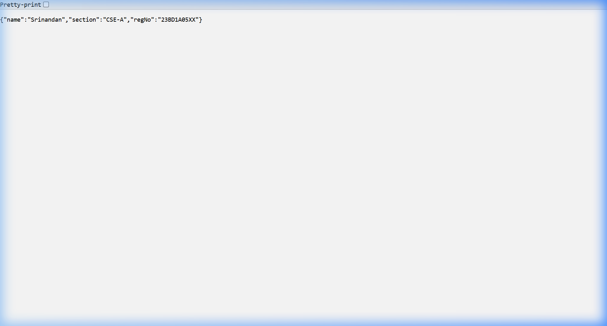
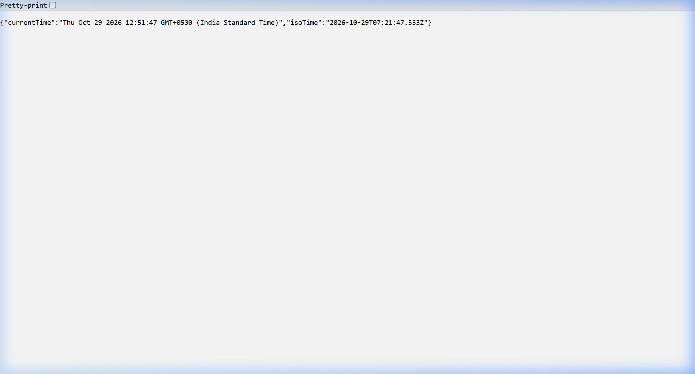
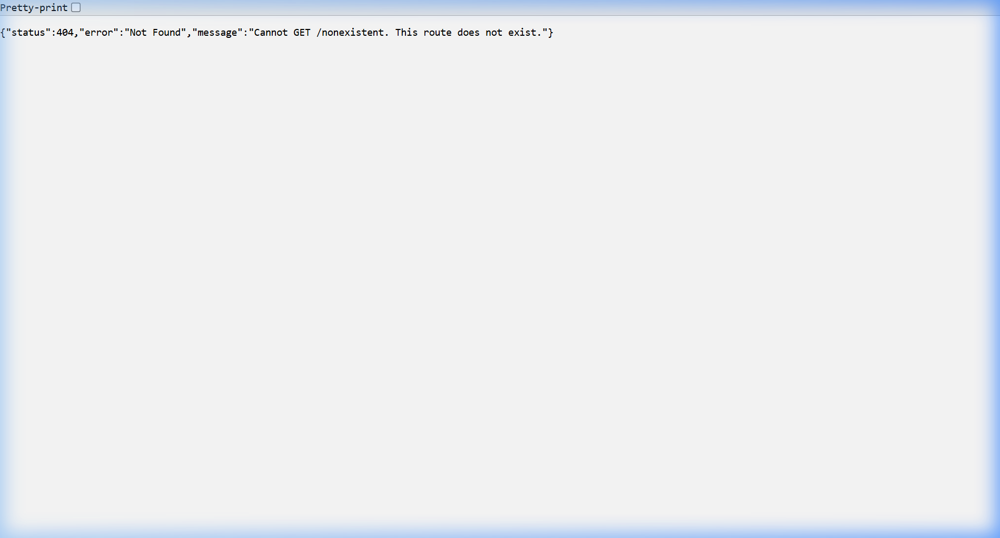

# Lab 1: Node.js and Express server

**Course:** Backend Development Fundamentals · Year II Term II · Aurora  
**Faculty:** Chintakrindi Sai Siva Teja  
**Student Details:** Srinandan · Roll No: 1205 · Section: 214  

---

## Live Link
- **Deployment Status:** Not applicable (Developed and tested in local Node.js environment; verified and documented with browser screenshots for every endpoint below)
- **GitHub Repository:** [https://github.com/purimetlasrinandan-netizen/BDF-LAB-1-Srinandan-CSE-2D-214-](https://github.com/purimetlasrinandan-netizen/BDF-LAB-1-Srinandan-CSE-2D-214-)

---

## How to Run

### Prerequisites
- [Node.js](https://nodejs.org/) (v18.x or later installed)
- [npm](https://www.npmjs.com/) (bundled with Node.js)

### Installation
1. Clone the repository and navigate to the `lab-01` directory:
   ```bash
   git clone https://github.com/purimetlasrinandan-netizen/BDF-LAB-1-Srinandan-CSE-2D-214-.git
   cd BDF-LAB-1-Srinandan-CSE-2D-214-/lab-01
   ```
2. Install dependencies:
   ```bash
   npm install
   ```

### Environment Variables
The application uses the following optional environment variables:
| Variable | Description | Default Value |
| :--- | :--- | :--- |
| `PORT` | The port number on which the server listens | `3000` |

*(Create a `.env` file in `lab-01` if custom variables are required. Never commit `.env` to Git).*

### Start Commands
- **Start Express Server (Default):**
  ```bash
  npm start
  ```
- **Start in Development Mode (with auto-reload):**
  ```bash
  npm run dev
  ```
- **Start Plain HTTP Server (Task 3):**
  ```bash
  npm run start:plain
  ```

---

## Endpoints / Scripts Table

### API Endpoints
| HTTP Method | Endpoint | Description | Expected Status |
| :--- | :--- | :--- | :--- |
| `GET` | `/` | Returns welcome message text | `200 OK` |
| `GET` | `/about` | Returns student details (name, section, rollNo) in JSON format | `200 OK` |
| `GET` | `/time` | Returns current date and time using `new Date()` | `200 OK` |
| `ALL` | `/*` (Unknown route) | Catch-all 404 handler returning JSON error message | `404 Not Found` |

### Scripts Defined in package.json
| Script | Command | Purpose |
| :--- | :--- | :--- |
| `npm start` | `node server.js` | Runs the main Express server on port 3000 |
| `npm run start:plain` | `node plain-server.js` | Runs the plain Node.js `http.createServer` server |
| `npm run dev` | `node --watch server.js` | Runs Express server with native Node.js file watcher |

---

## Screenshots

### 1. GET `/` - Welcome Text (Status: 200 OK)


---

### 2. GET `/about` - Student Info in JSON (Status: 200 OK)


---

### 3. GET `/time` - Current Date & Time (Status: 200 OK)


---

### 4. GET `/*` - 404 Not Found Handling (Status: 404 Not Found)


---

## Task Explanations

### Task 1: Explanation of `package.json` Fields
When `npm init -y` is run, a default `package.json` file is created. Here is what each key field signifies:
- `"name"`: The unique identifier/name of the project or package.
- `"version"`: The current version of the project following Semantic Versioning (`MAJOR.MINOR.PATCH`).
- `"description"`: A brief summary of what the project does.
- `"main"`: The primary entry point file of the application (e.g., `server.js`).
- `"scripts"`: A dictionary of custom CLI commands/shortcuts (e.g., `start`, `dev`) that can be executed via `npm run <script-name>`.
- `"keywords"`: An array of descriptive tags to help search and discover the package.
- `"author"`: The author or creator of the repository.
- `"license"`: Specifies the legal software license under which the code is distributed (e.g., `ISC` or `MIT`).
- `"dependencies"`: Key-value map of external production packages required by the application (e.g., `"express": "^5.3.0"`).
- `"type"`: Defines the module system (`"commonjs"` for `require()` or `"module"` for ES6 `import`).

### Task 2: Express in `node_modules`
Running `npm install express` downloaded Express and its transitive dependencies into the `node_modules/` directory, while recording the exact resolved version in `package-lock.json` and adding `express` under `"dependencies"` in `package.json`.

---

## Viva Questions & Answers

### 1. What is the difference between `package.json` and `node_modules`?
- **`package.json`**: A lightweight metadata manifest file committed to Git. It lists the project name, scripts, and dependencies needed to run the project.
- **`node_modules`**: The directory that stores the actual installed code and compiled binaries for all dependencies and sub-dependencies. Because it can be hundreds of megabytes, it is **never** committed to version control and is ignored via `.gitignore`. Running `npm install` restores `node_modules` at any time from `package.json`.

### 2. What does `app.listen()` do?
- In Express, `app.listen(port, callback)` binds and listens for incoming HTTP connections on the specified network port and host. Under the hood, it creates a Node.js `http.Server` instance using `http.createServer(app)` and begins accepting client requests.

### 3. What do `request` and `response` represent?
- **`request` (`req`)**: An object representing the incoming HTTP request from the client/browser. It contains headers, query parameters, URL path, HTTP method, request body, cookies, and IP address.
- **`response` (`res`)**: An object representing the outgoing HTTP response sent back to the client. It provides methods like `res.status()`, `res.send()`, `res.json()`, and `res.setHeader()` to construct and transmit headers, status codes, and data.

---

## Notes: Problems Faced and Solutions
1. **Port Collision (`EADDRINUSE: address already in use :::3000`):**
   - *Problem:* A previously running background Node process was occupying port 3000, preventing the new server from binding.
   - *Solution:* Used PowerShell `Get-NetTCPConnection -LocalPort 3000` to find the owning process ID (PID 344) and terminated it with `Stop-Process -Id 344 -Force`, freeing port 3000. Configured `process.env.PORT || 3000` to allow dynamic port allocation on hosting providers.
2. **Preventing Accidental Commits of Heavy Directories:**
   - *Problem:* Committing `node_modules` degrades Git performance and violates repository standards.
   - *Solution:* Created a root `.gitignore` file specifying `node_modules/` and `.env` before making initial commits.
