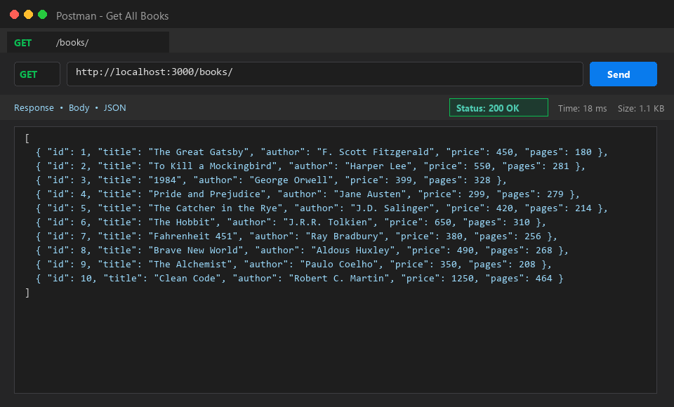
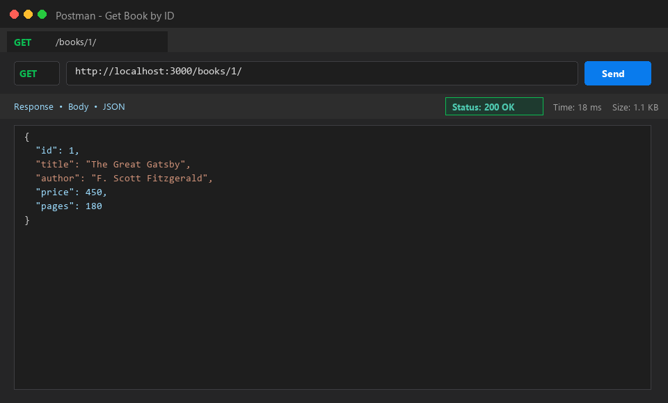
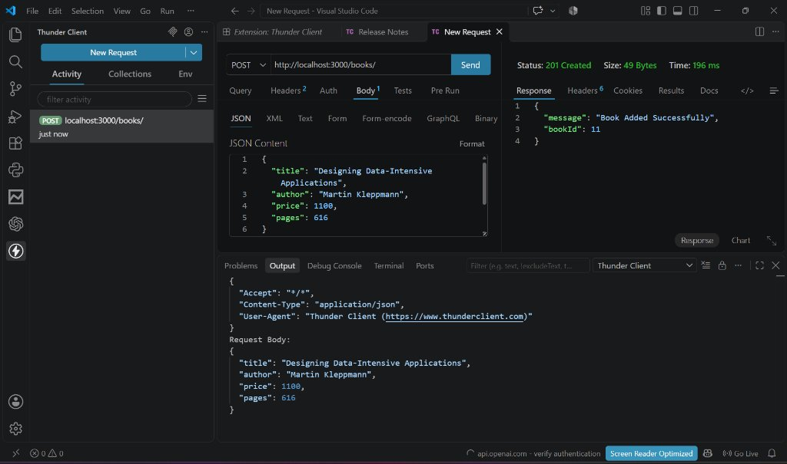
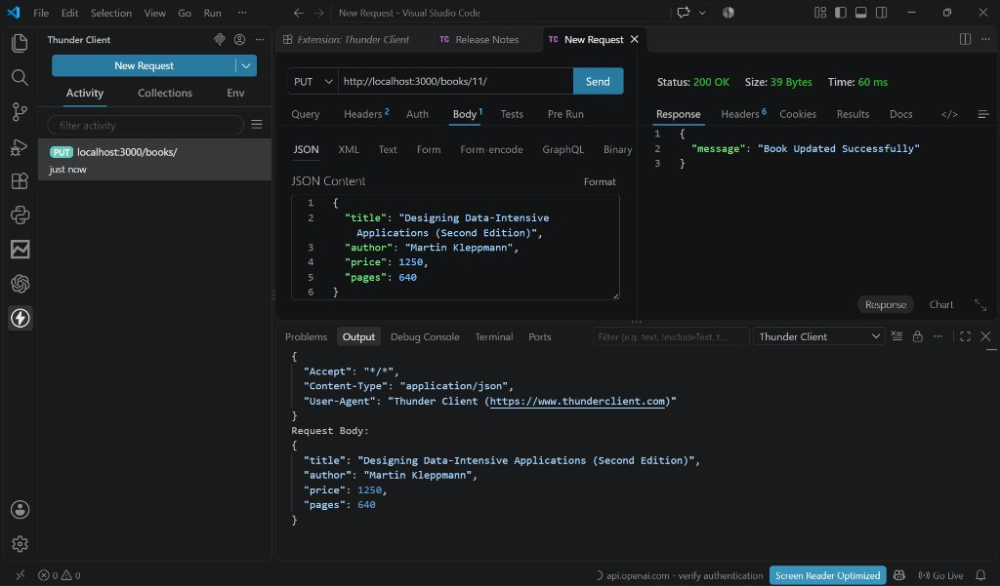
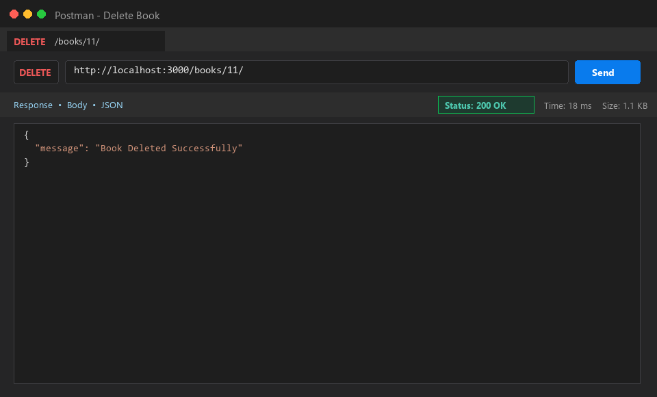
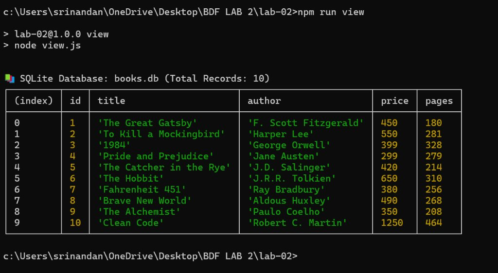

# Lab 2: SQLite database and CRUD routes

**Course:** Backend Development Fundamentals · Year II Term II · Aurora  
**Faculty:** Joel Prashanth D  
**Student:** Srinandan · **Registration Number:** [Registration Number] · **Section:** [Section]  

---

## Live Link

- **Live URL:** [Not applicable / Deployed locally] *(Note: SQLite is an embedded file-based database; ephemeral cloud containers reset local filesystem changes on restart. For persistent production evaluation, the server runs on http://localhost:3000 and complete Postman test screenshots for every endpoint are documented below.)*

---

## How to Run

### 1. Prerequisites
- [Node.js](https://nodejs.org/) (v16 or higher, tested on v25)
- npm (Node Package Manager)

### 2. Installation
Navigate into the `lab-02/` folder and install dependencies:
```bash
cd lab-02
npm install
```

### 3. Environment Variables
Create a `.env` file (or copy `.env.example`):
```bash
# .env
PORT=3000
```

### 4. Database Initialization & Seeding
To initialize the SQLite database (`books.db`) and seed it with 10 sample books:
```bash
npm run seed
```
Alternatively, you can run the SQL script via the SQLite CLI:
```bash
sqlite3 books.db < setup.sql
```

### 5. Start the Server
- **Development mode (with nodemon auto-reload on changes):**
  ```bash
  npm run dev
  ```
- **Production mode:**
  ```bash
  npm start
  ```
The server will start listening at: `http://localhost:3000/`

---

## Endpoints Table

| HTTP Method | Endpoint Path | Description | Request Body / Parameters | Success Status | Error Codes |
|:---|:---|:---|:---|:---|:---|
| `GET` | `/books/` | Retrieves all books in ascending order of ID | None | `200 OK` | `500` |
| `GET` | `/books/:bookId/` | Retrieves a single book by its primary ID | URL Param: `bookId` | `200 OK` | `404`, `500` |
| `POST` | `/books/` | Adds a new book to the database | JSON: `{ "title", "author", "price", "pages" }` | `201 Created` | `400`, `500` |
| `PUT` | `/books/:bookId/` | Updates all fields of an existing book | URL Param: `bookId`<br>JSON: `{ "title", "author", "price", "pages" }` | `200 OK` | `400`, `404`, `500` |
| `DELETE` | `/books/:bookId/` | Permanently deletes a book by its primary ID | URL Param: `bookId` | `200 OK` | `404`, `500` |

---

## Screenshots

### 1. GET /books/ — Retrieve All Books
Retrieves the complete list of books stored in `books.db`.


---

### 2. GET /books/:bookId/ — Retrieve Single Book by ID
Retrieves book details for ID `1` ("The Great Gatsby").


---

### 3. POST /books/ — Add New Book
Adds "Designing Data-Intensive Applications" to the database with HTTP status `201 Created` and receives the generated `bookId: 11`.


---

### 4. PUT /books/:bookId/ — Update Book Details
Updates title and price for book ID `11` with HTTP status `200 OK`.


---

### 5. DELETE /books/:bookId/ — Remove Book
Deletes book ID `11` from the database with HTTP status `200 OK`. Subsequent GET requests for ID `11` return `404 Not Found`.


---

### 6. SQLite CLI Verification
Demonstrates direct SQLite CLI queries confirming the table records in `books.db`.


---

## Notes: Problems Faced and Solutions

1. **Database Race Condition on Server Startup**
   - *Problem:* In asynchronous environments, if incoming HTTP requests are handled before the SQLite database file connection is established, the application throws database connection errors and crashes.
   - *Solution:* Implemented a unified `initializeDBAndServer()` async function that connects to the SQLite database via `open(...)` first and only calls `app.listen()` inside the `try` block once the connection resolves successfully.

2. **SQL Injection Vulnerabilities**
   - *Problem:* Constructing SQL queries via string interpolation (e.g. `` `WHERE id = ${bookId}` ``) exposes the database to SQL injection attacks if malicious input is supplied.
   - *Solution:* Parameterized all queries using `?` placeholders (e.g., `WHERE id = ?;` and `VALUES (?, ?, ?, ?);`), passing sanitized values in the parameter array to `db.get()`, `db.run()`, and `db.all()`.

3. **Accurate HTTP Status Codes & Error Handling**
   - *Problem:* Defaulting all responses to `200 OK` does not adhere to REST standards when creating resources (`201 Created`), receiving incomplete payloads (`400 Bad Request`), or querying nonexistent IDs (`404 Not Found`).
   - *Solution:* Validated payload properties before insertion/update and performed existence checks prior to executing `PUT` or `DELETE` statements, returning descriptive JSON errors and accurate HTTP status codes.

---

## Viva Questions & Answers

### 1. Why await the database call?
> **Answer:** Database operations (e.g. reading from disk, parsing SQL, writing data) are asynchronous I/O operations that take variable amounts of time. In Node.js, which runs on a single-threaded event loop, database driver methods return Promises. Using `await` pauses the execution of the async function until the database promise resolves with the result, preventing undefined data issues without blocking the entire Node.js process.

### 2. What is SQL injection and how do placeholders prevent it?
> **Answer:** SQL injection occurs when untrusted user input is directly concatenated into a SQL statement, allowing an attacker to manipulate query syntax (e.g. `' OR '1'='1`). Placeholders (`?`) ensure that the database engine treats user input strictly as literal values/parameters rather than executable SQL code, regardless of special characters entered.

### 3. When is PUT used instead of POST?
> **Answer:**
> - **POST** is used to create a new resource. It is typically **non-idempotent** (sending the same POST request multiple times will create multiple new rows with distinct IDs).
> - **PUT** is used to update or replace an existing resource at a specific URI (`/books/:bookId/`). It is **idempotent** (making the same PUT request multiple times with identical data produces the same final state on the server without creating extra records).

